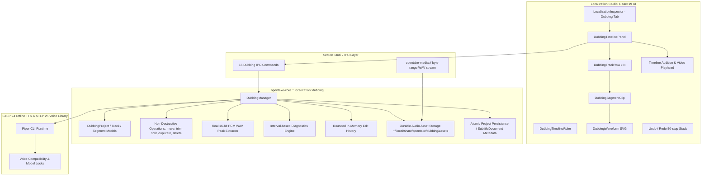

# Architecture: Professional AI Dubbing Timeline

> **Open Media Workbench — STEP 26 Architecture Specification**  
> Status: Implemented & Verified (STEP 26)  
> Workspace: Localization Studio

---

## 1. Executive Summary

The **Professional AI Dubbing Timeline** introduces a multi-track audio segment editor directly into Open Media Workbench's Localization Studio. It establishes non-destructive editing workflows, authentic waveform visualization, timeline-aligned speech placement, safe cue regeneration, gap/overlap diagnostics, video playhead synchronization, and atomic project persistence.

Operating 100% locally and offline via on-device Piper TTS inference, this architecture preserves source media and original subtitles with absolute immutability. No cloud APIs, no external telemetry, and no destructive audio modifications are permitted.

---

## 2. Canonical Dubbing Domain Model

All timeline coordinates use microsecond-level integer precision (`MediaTimeUs`), completely eliminating floating-point drift across hours of playback.

### 2.1 Core Entities

1. **`DubbingProject`**: Root container storing project identifiers, source media reference, timeline duration, source and target languages, track list, asset manifest, and timestamps.
2. **`DubbingTrack`**: Independent audio track lane containing stable ID, display name, target language, assigned voice ID, speaker ID, mute/solo states, and list of segment IDs.
3. **`DubbingSegment`**: Timeline audio clip placed at a specific microsecond timecode.
   - `timeline_start_us`: Placement offset on the global timeline.
   - `source_in_us` / `source_out_us`: Non-destructive trim points into the underlying audio asset.
   - `trimmed_duration_us()`: Computed as `source_out_us - source_in_us`.
   - `timeline_end_us()`: Computed as `timeline_start_us + trimmed_duration_us()`.
   - `original_cue_start_us` / `original_cue_end_us`: Reference timestamps of the original subtitle cue.
   - `cue_overrun_us()`: Duration by which effective audio exceeds the original subtitle display interval.
4. **`DubbingAudioAsset`**: Durable on-disk audio file record with content hash, sample rate (e.g., 22,050 Hz), channels (mono 1), bit depth (16-bit PCM), duration in microseconds, and byte size.

### 2.2 Invariant Time Rules

- **Zero-Byte Source Media Immutability:** Neither the original video nor source audio soundtrack are altered or rewritten.
- **Subtitle Independence:** Subtitle cue text, display start times, and display end times remain strictly untouched.
- **Audio Sample Preservation:** Trimming or splitting audio clips never re-encodes, modifies, or truncates the underlying WAV file.
- **Overflow-Safe Arithmetic:** All operations use checked or bounded integer math rejecting negative values and invalid bounds.

---

## 3. Durable Audio Asset Storage

Generated speech WAV files from Piper TTS originally reside in temporary staging directories. To ensure projects saved today reopen reliably tomorrow, assets are copied atomically into durable app-managed storage:

- **Location:** `~/.local/share/opentake/dubbing/assets/{asset_id}.wav`
- **Content Addressing & Provenance:** Assets are indexed by stable GUIDs with SHA-256 validation.
- **Protocol Streaming:** The desktop app serves audio to `<audio>` elements and Web Audio through the custom `opentake-media://localhost/{asset_id}` protocol handler using secure byte-range HTTP streaming, without exposing local filesystem paths to the browser context.
- **Reference Tracking:** Deleting a segment reference does not purge the physical audio asset if another segment (e.g. from a split or duplicate) or undo history still references it.

---

## 4. Real Waveform Peak Extraction

To deliver authentic visual editing without decoding entire audio files on every render:

1. **PCM Parser:** Reads standard 16-bit signed integer mono samples directly from the durable WAV asset.
2. **Adaptive Binning:** Divides samples into a requested number of bins (e.g. 50–300 bins depending on visual width).
3. **Min/Max Bounding:** Computes the minimum and maximum sample peaks per bin normalized to `[-1.0, 1.0]`.
4. **Slice-Aware Visualization:** Waveform requests take `source_in_us` and `source_out_us` parameters, generating peak bins strictly for the trimmed window of the audio asset.
5. **Caching:** Results are cached in `DubbingTimelineWaveform` structures and invalidated only when the underlying audio asset changes.

---

## 5. Non-Destructive Editing Operations

All timeline operations execute through a unified command pattern with full 50-step undo and redo capabilities:

| Operation | Implementation | Description |
| :--- | :--- | :--- |
| **Move** | `move_segment(id, new_start_us)` | Updates `timeline_start_us` without altering source trim boundaries or audio assets. |
| **Trim Start** | `trim_segment_start(id, new_in_us)` | Advances `source_in_us` and shifts `timeline_start_us` forward by the same delta, preserving the segment's tail position. |
| **Trim End** | `trim_segment_end(id, new_out_us)` | Decreases `source_out_us` to end playback earlier, reducing `trimmed_duration_us`. |
| **Split** | `split_segment(id, split_timeline_us)` | Divides one segment into two adjacent segments at the playhead. The left segment covers `[source_in_us, split_offset]`, and the right segment covers `[split_offset, source_out_us]`. Both reference the same untouched audio asset. |
| **Duplicate** | `duplicate_segment(id)` | Clones the segment with a new GUID, placed immediately after the original segment, sharing the audio asset reference. |
| **Delete** | `delete_segment(id)` | Removes the segment from the track while retaining the asset in storage for undo safety. |
| **Gain** | `set_segment_gain(id, gain)` | Adjusts visual audition volume multiplier (0.0 to 2.0). |
| **Change Track** | `change_segment_track(id, new_track_id)` | Moves a segment between compatible tracks with language consistency validation. |

---

## 6. Gap, Overlap & Synchronization Diagnostics

The validation engine runs high-performance interval tests ($O(N \log N)$ sorting with contiguous sweep) after each operation:

- `SEGMENT_OVERLAP`: Warns when two audio clips on the same track occupy overlapping microsecond ranges.
- `SEGMENT_EXCEEDS_SUBTITLE_INTERVAL`: Flags speech segments whose duration overruns the original subtitle cue display window.
- `MISSING_AUDIO_ASSET`: Identifies segments whose underlying WAV file is missing or unreadable on disk.
- `UNRESOLVED_VOICE_ASSIGNMENT`: Warns when a track has no assigned TTS voice model.
- `LANGUAGE_VOICE_MISMATCH`: Warns when the assigned voice language differs from the track language.
- `LARGE_DIALOGUE_GAP`: Informational diagnostic highlighting quiet gaps (>10s) between consecutive dialogue segments.

---

## 7. Segment Regeneration & Rollback Safety

When a user triggers segment regeneration:
1. The existing audio asset is preserved as a fallback.
2. Piper TTS synthesizes new speech for the segment's current text.
3. The replacement WAV is verified for duration, sample rate, and integrity.
4. If synthesis succeeds, the new audio asset is durably stored and atomically attached to the segment, with trim points reset to cover `[0, new_duration_us]`.
5. If synthesis fails or is cancelled, the previous audio asset remains active, and a descriptive error is surfaced without altering timeline state.

---

## 8. Playback Audition & Playhead Synchronization

- **Single Master Playhead:** The main video player (`videoRef`) is the authoritative clock for both subtitle overlays and dubbing audio playback.
- **Timeline Scrubbing:** Clicking or scrubbing the horizontal ruler or track lane seeks the video player to that exact microsecond.
- **Segment Audition:** Users can play individual segments in isolation or audition the full multi-track dubbing timeline in sync with video.
- **Mute & Solo:** Tracks feature mute and solo toggles respected during auditioning.
